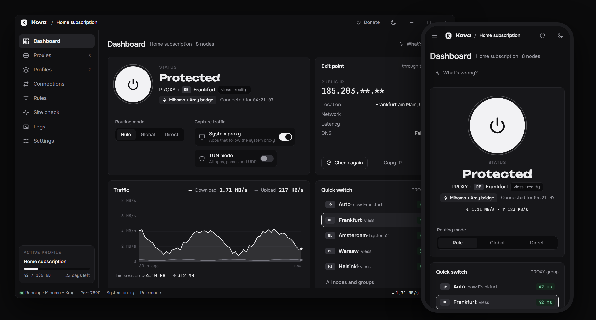
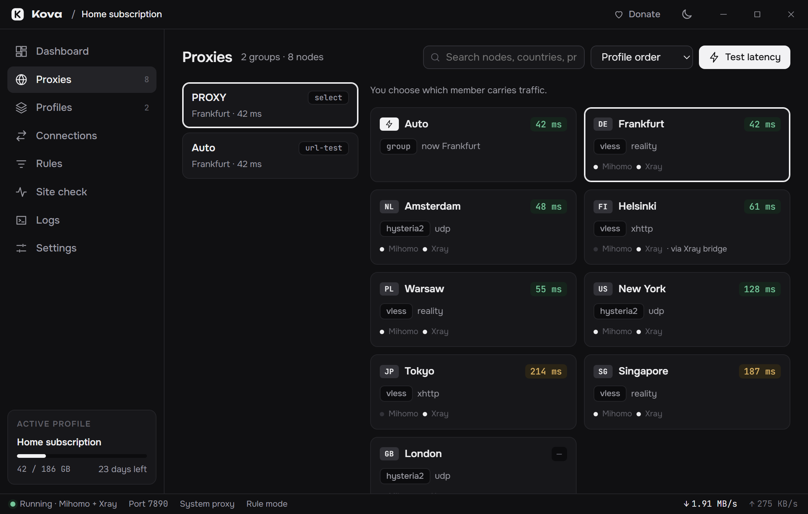
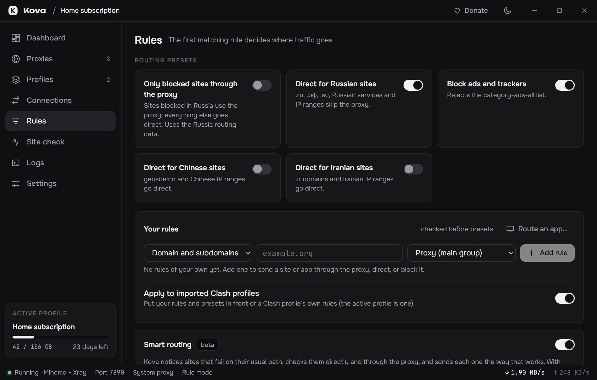

<p align="center"></p>
<h1 align="center">Kova</h1>
<p align="center">A VPN client for the <b>Mihomo</b> and <b>Xray</b> cores, written in Rust.<br>Windows · Android (phones and TV) · Linux · macOS</p>
<p align="center">
  <a href="https://github.com/scarletjess77/kova/releases/latest"></a>
  <a href="https://scarletjess77.github.io/kova/"></a>
  <a href="LICENSE"></a>
</p>



## Features

- **Both cores in one app.** Mihomo runs in front; nodes only Xray can run (such as VLESS over XHTTP) are bridged through Xray automatically.
- **Any subscription.** Clash/Mihomo YAML kept as is, share links (`vless`, `vmess`, `trojan`, `ss`, `hysteria2`, `tuic`, `wireguard`, `anytls`, `socks`), base64, sing-box JSON and Xray JSON. Import from the clipboard, a file, a QR code, or another device on the same network.
- **Routing.** Presets (Russia, China, Iran direct; ad blocking; only blocked sites through the proxy), rules for sites and apps, and [smart routing](docs/how-it-works.md#smart-routing-beta), which learns sites that fail on their usual path.
- **Works where GitHub is blocked.** Cores and routing data ship with the app; missing data is fetched through the server once connected.
- **Against blocking.** Anti-DPI (beta) splits the start of each connection so simpler filtering can't recognise it; on Android a separate server can be chosen for mobile data, where networks may allow only whitelisted sites; the kill switch (beta) keeps apps offline when the connection drops and reconnects.
- **Backup and transfer.** Every profile and the settings in one file, encrypted with a password if one is given, to restore on another device.
- **Checks.** "What's wrong?" diagnostics, a site check (direct and through Kova), a privacy check (exit IP, encrypted DNS, IPv6 leaks) and a speed test.
- **TUN mode** on Windows without running as administrator, through a small [service](docs/how-it-works.md#tun-mode-and-the-kova-service); on Linux after granting rights once. On Android: a per-app VPN, a quick-settings tile, a widget and always-on support.
- **Safe by default.** Subscriptions are stored encrypted on Windows (DPAPI) and owner-only elsewhere, downloads are checked by SHA-256, updates are signed, the core controller listens on localhost only with a secret, and the system proxy is restored after a crash.
- **English, Russian, Persian and Chinese**, and 12 themes: dark, light, OLED black, dim, warm paper, high contrast, Night sky (pixel stars, with the moon showing what is left of the subscription), Nord, Catppuccin, Dracula, Gruvbox and Solarized.

<p>
  
  
</p>

## Download

The latest build is on the [Releases](https://github.com/scarletjess77/kova/releases/latest) page, one file per system:

| System | File |
|---|---|
| Windows 10/11 | `Kova_<version>_Windows.exe` |
| Android 7+, phones and TV | `Kova_<version>_Android.apk` |
| Linux | `Kova_<version>_Linux.deb` (includes the cores) or `Kova_<version>_Linux.AppImage` (smaller; downloads the cores on first start) |
| macOS, Apple silicon and Intel | `Kova_<version>_macOS.dmg` |

`latest.json` and the `.app.tar.gz` are for Kova's own updater. Kova updates itself (Settings → Updates). Windows and Android are the most tested; Linux and macOS builds are newer. The Windows installer is not code-signed yet, so SmartScreen may warn.

## Privacy

No accounts, ads or telemetry. Kova contacts other services only for these features:

- **Exit point** on the dashboard: `ipwho.is` (or `ipinfo.io`).
- **Privacy check:** `ipify.org`. **Speed test:** `speed.cloudflare.com`.
- **Site check:** the sites in its list, only when it is run.
- **Updates:** `github.com`, for Kova, the cores and the routing data.
- **Subscription updates** carry a random device ID made once per install (not a hardware ID); providers with device limits count devices by it.

## Documentation

- [User guide](https://scarletjess77.github.io/kova/guide.html), in English, Russian, Persian and Chinese.
- [How it works](docs/how-it-works.md): the two cores, TUN mode and the Kova service, routing data, smart routing, Android, and notes for VPN providers (`kova://` import links).
- [Building and testing](docs/building.md): desktop and Android builds, tests, releases.
- [Security policy](SECURITY.md): how to report a vulnerability.

## Support

Kova is free. Development can be supported with TON:

```
UQCfiJW3GM9sEfYS2fsk-q9WNbKXXn3m0KU17Dx5XTCs3fv0
```

The same address, with a QR code, is under **Donate** in the app.

## License

Copyright © 2026 scarletjess77. [GPL-3.0-or-later](LICENSE).
